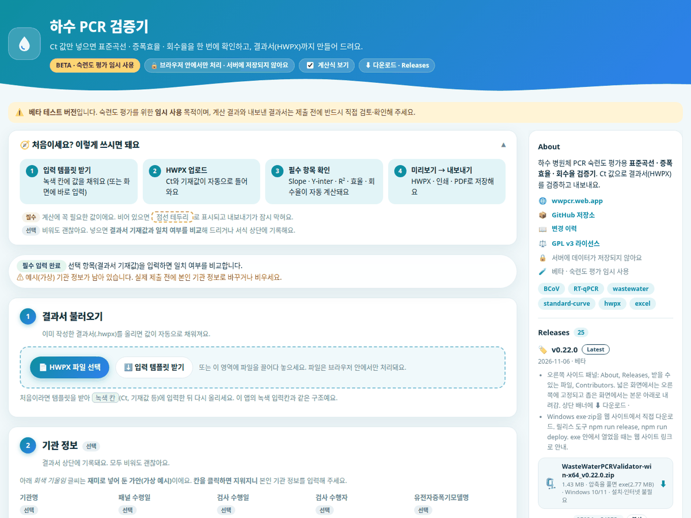
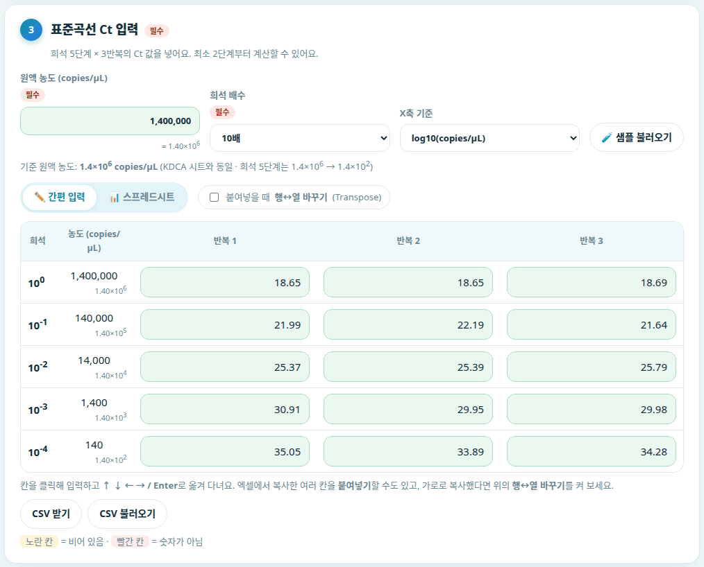
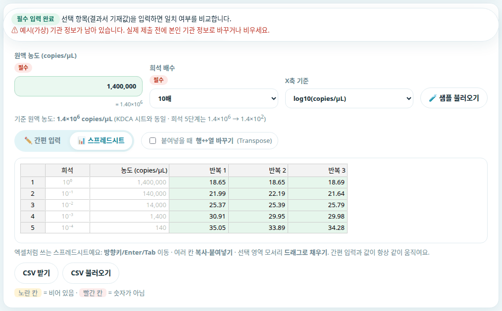
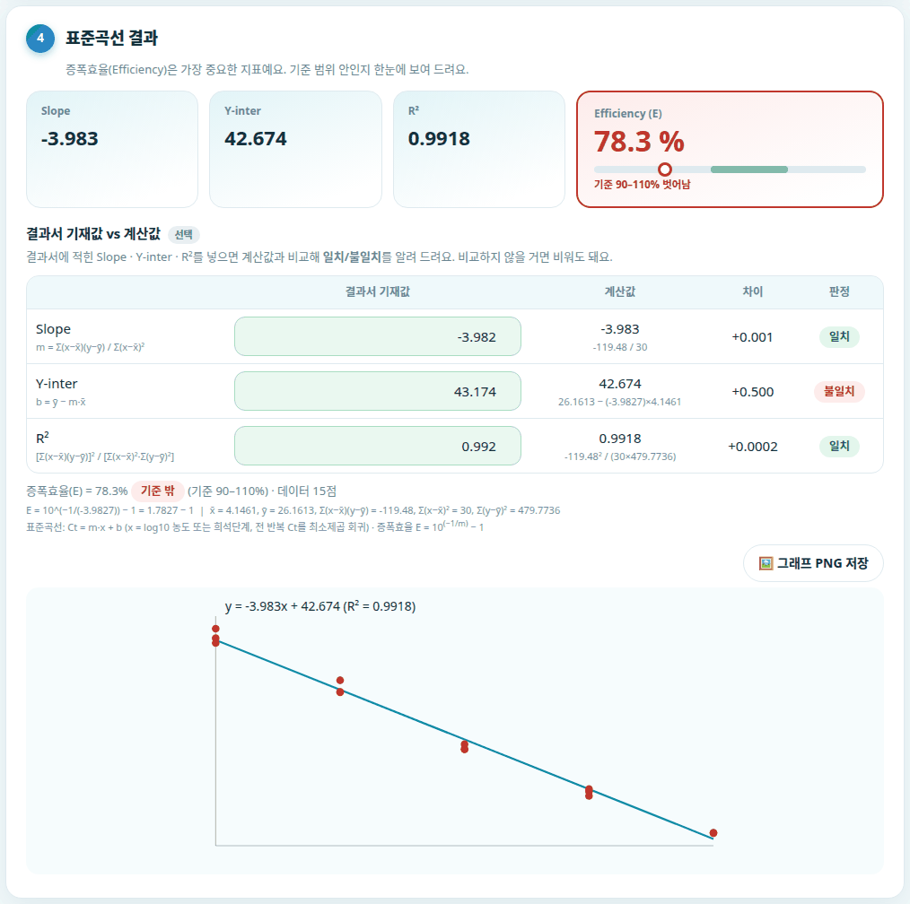
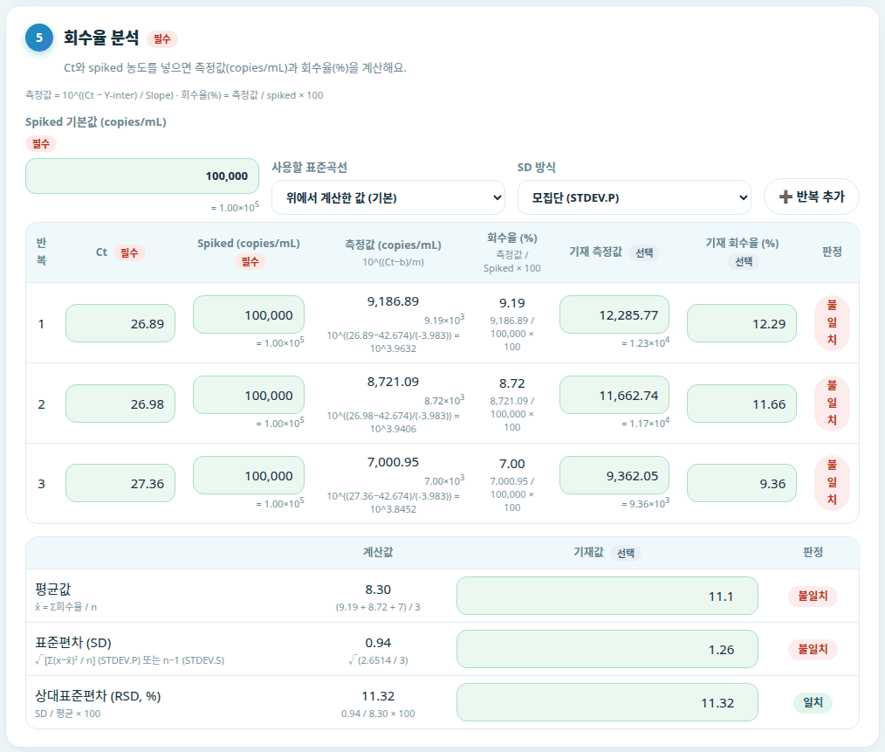
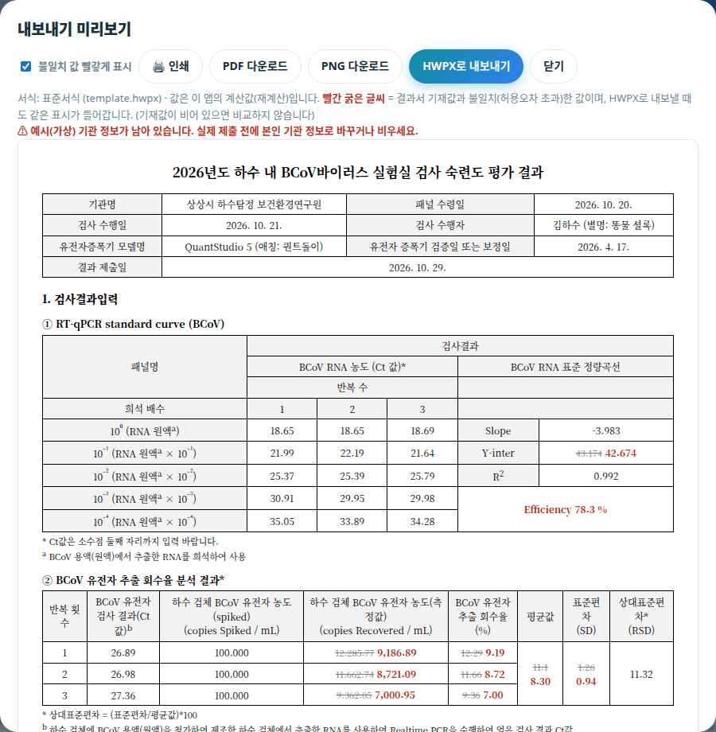
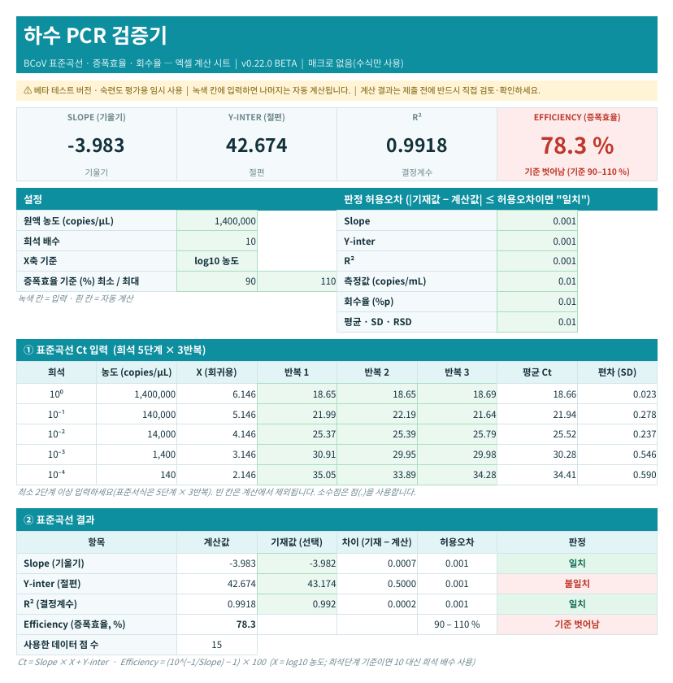
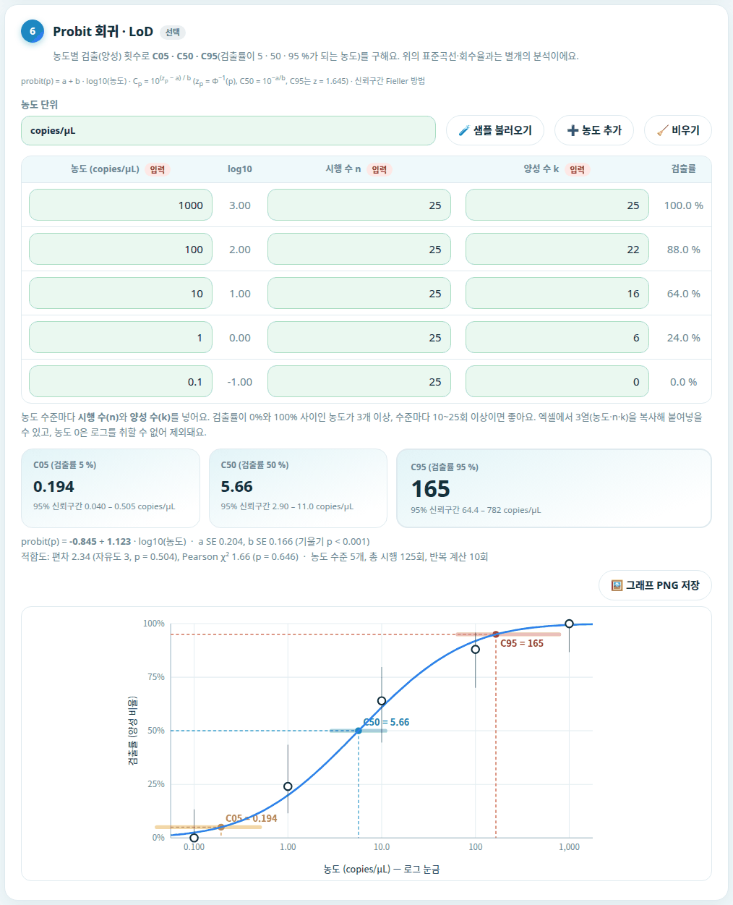

# 하수 PCR 검증기 (WasteWater PCR Validator)

[](https://github.com/CHOICHI-HWAN/WasteWaterPCRValidator/actions/workflows/ci.yml)


[](https://wwpcr.web.app)


[English](README.md)

> **안내: 베타 버전이며 숙련도 평가 기간의 임시 사용을 위한 도구입니다.** *하수 내 병원체 검출검사 숙련도 평가*(BCoV RT-qPCR)의 숫자를 다시 확인하는 일을 돕기 위해 만들었습니다. **검증된 실험실 시스템이 아니라 베타 소프트웨어**입니다. 계산 결과와 내보낸 결과서는 **제출하기 전에 반드시 사람이 검토·확인**해야 하며, 어떠한 보증도 제공하지 않습니다.

**바로 써보기: <https://wwpcr.web.app>** (샘플 데이터 데모: <https://wwpcr.web.app/?demo=1>) · [Windows 앱](#windows-앱-exe) · [엑셀 계산 시트](#엑셀-계산-시트)

BCoV 표준곡선과 추출 회수율 시료의 Ct 값을 넣으면 **Slope, Y 절편, R², 증폭효율(Efficiency), 회수율을 다시 계산**하고, 결과서(HWPX)에 적힌 값과 비교해 **고친 결과서를 만들어 주는** 브라우저 도구입니다. 서버로는 아무것도 전송하지 않습니다.



## 주요 기능

### 숫자 확인

1. **Ct 원자료로 표준곡선 계산.** 모든 점(희석 5단계 × 3반복, 빈 칸은 제외)에 최소제곱 회귀를 적용해 Slope, Y 절편, R²를 구합니다. 기준 원액 농도는 **1.4 × 10⁶ copies/µL**(KDCA 시트 기준)이며, 다른 값을 쓰면 경고합니다.
2. **증폭효율을 가장 눈에 띄게.** `E = 10^(−1/Slope) − 1`을 설정 가능한 기준 범위(기본 90–110 %)와 함께 게이지로 보여 주고, 내보낸 결과서와 엑셀에도 넣습니다.
3. **결과서와 비교.** 결과서에 적힌 값을 입력(또는 업로드)하면 항목마다 허용오차 기준으로 *일치 / 불일치*를 판정합니다. 허용오차는 바꿀 수 있습니다(기본: Slope·Y-inter·R² 0.001, 나머지 0.01).
4. **회수율 분석.** Ct와 spiked 농도로 측정값(copies/mL)과 회수율(%), 평균·SD(모집단/표본)·RSD를 계산합니다. 표준곡선은 위에서 계산한 값(기본) 또는 결과서에 적힌 값을 고를 수 있습니다.
5. **계산식에 실제 숫자를 대입해서 표시**(`−119.48 / 30`, `26.1613 − (−3.9827)×4.1461`)하므로 손으로 검산할 수 있습니다. 상단 스위치로 숨길 수 있습니다.

5b. **Probit 회귀 / 검출 한계(LoD).** 농도별 시행 횟수와 양성 횟수로 `probit(p) = a + b·log10(농도)`를 최대우도로 적합하고, **C05 · C50 · C95**(검출률 5 · 50 · 95 %가 되는 농도)를 Fieller 95% 신뢰구간, 적합도, 검출률 곡선과 함께 보여 줍니다. 외삽, 넓은 신뢰구간, 완전 분리 같은 경우는 경고합니다. 독립 최적화와 공개 고전 자료로 검증했습니다.

### 결과서(HWPX)

6. **작성한 결과서 읽기.** `.hwpx` 결과서를 올리면 Ct, 기재된 Slope·Y-inter·R², 회수율 행, 기관 정보를 브라우저 안에서 읽습니다(업로드되지 않음).
7. **표준서식과 입력 템플릿.** 서식이 내장되어 있고, 입력 칸을 녹색으로 표시한 빈 템플릿을 받아 한글에서 채운 뒤 다시 올릴 수 있습니다.
8. **내보내기.** 고친 결과서(HWPX)는 원래 서식을 유지하며, **기재값과 다른 값은 빨간색 굵은 글씨**로 들어갑니다. 직접 그린 *BCoV standard curve* 그림과 Efficiency가 추가됩니다. 실제 결과서처럼 보이는 **미리보기**, **인쇄**, **PDF**, **PNG**를 지원합니다.

### 편하게 입력하기

9. **Ct 입력 방식 두 가지**: 간편 입력 표 또는 진짜 스프레드시트([Jspreadsheet CE](https://github.com/jspreadsheet/ce))이며 같은 데이터를 공유합니다. 방향키·Enter·Tab 이동, 엑셀 붙여넣기(행↔열 바꾸기 지원, 3×5 모양은 자동), 드래그 채우기, CSV 입출력.
10. **엄격한 숫자 해석.** `18,65`(소수점 쉼표)나 `18.65abc`를 조용히 1865나 18.65로 읽지 않고 **이유와 함께 거부**합니다. 천 단위 쉼표, `1.4e6`, `%`, 전각 숫자는 허용합니다. 표시용 반올림은 엑셀·한글과 같습니다(`1.005 → 1.01`).
11. **필수/선택 표시, 날짜 달력과 검증, 큰 수의 천 단위 쉼표와 과학 표기.**

### 가져가서 쓰기

12. **수식이 살아 있는 엑셀 시트** — 현재 입력값, `SLOPE/INTERCEPT/RSQ`, 판정, 추세선 그래프가 들어 있고 매크로는 없습니다. LibreOffice로 수식을 다시 계산해 앱 결과와 일치함을 확인했습니다.
13. **Windows 앱(2.8 MB)** — 파일 하나, 설치·인터넷 불필요, 브라우저로 열리고 탭을 닫으면 스스로 종료됩니다.
14. **설계부터 비공개.** 입력값과 업로드한 파일은 이 컴퓨터 밖으로 나가지 않습니다. (웹 사이트는 익명 방문 통계를 기록하며, Windows 앱은 외부 연결을 하지 않습니다.)

## 화면

| | |
|---|---|
|  |  |
| 표준곡선 Ct 입력(간편 입력)과 기준 농도 안내 | 같은 데이터를 스프레드시트 탭에서 |
|  |  |
| Slope · Y-inter · R² · Efficiency 카드와 결과서 대비 일치/불일치 | 계산식이 대입된 회수율, 평균·SD·RSD |
|  |  |
| 내보내기 미리보기(불일치는 빨간 굵은 글씨, 인쇄·PDF·PNG·HWPX) | 엑셀 계산 시트(수식, 매크로 없음) |
|  | |
| Probit 회귀: C05 / C50 / C95와 95% 신뢰구간, 검출률 곡선(예시 자료) | |

## 사용 방법

### 웹 앱 (권장)

1. <https://wwpcr.web.app>을 엽니다.
2. **불러오기**: 작성한 결과서(`.hwpx`)를 올리거나, **입력 템플릿**을 받아 녹색 칸을 채워 올리거나, Ct 값을 직접 입력합니다(**샘플 불러오기**로 먼저 둘러볼 수 있습니다).
3. **표시 확인**: *필수* 입력을 채우면 결과 카드, 일치/불일치 열, Efficiency 게이지가 입력하는 대로 갱신됩니다.
4. **내보내기**: *미리보기* → **HWPX**, **인쇄 / PDF**, **PNG**, 또는 **엑셀 계산 시트**. 오른쪽 패널에 받을 수 있는 파일이 모여 있습니다.

### Windows 앱 (exe)

웹 사이트의 **Releases** 패널에서 zip을 받아 풀고 `WasteWaterPCRValidator-win-x64.exe`를 더블클릭합니다(빌드는 [docs/RELEASING.md](docs/RELEASING.md)). Windows 10/11 64비트. 기본 브라우저에서 `http://127.0.0.1:47321/`로 열리고, 오프라인으로 동작하며, 탭을 닫으면 몇 초 뒤 스스로 종료됩니다. **코드 서명이 없어** 처음 한 번 SmartScreen 경고가 뜰 수 있으며 *추가 정보 → 실행*을 누르면 됩니다(zip 안에 확인용 SHA-256이 있습니다).

### 엑셀 계산 시트

*내보내기 → 엑셀 계산 시트*. 녹색 칸이 입력이고 나머지는 모두 수식입니다. 배너, 결과 카드, 판정, 그래프가 있고 A4로 인쇄됩니다.

### 로컬에서 실행 / 개발

빌드 과정 없이 정적 파일만으로 동작합니다.

```bash
git clone https://github.com/CHOICHI-HWAN/WasteWaterPCRValidator.git
cd WasteWaterPCRValidator
python3 -m http.server 8000 --directory public    # 브라우저에서 http://localhost:8000
npm test                                           # 단위 테스트 (Node 18+)
```

| 명령 | 하는 일 |
|---|---|
| `npm test` | 계산, 숫자 해석, 반올림, probit, 버전 일관성 테스트 |
| `npm run sync-docs` | `LICENSE` / `CHANGELOG` / `THIRD_PARTY_NOTICES`를 `public/`으로 복사(앱에서 표시) |
| `npm run build:exe` | Go로 Windows exe 빌드(`tools/build-exe.mjs`의 `--arm64`, `--linux` 옵션) |
| `npm run release` | exe와 zip, 사이트 Releases 패널용 `releases.json` 생성 |
| `npm run deploy` | `release` 후 Firebase Hosting 배포 |

## 계산 방법

| 항목 | 식 |
|---|---|
| X (회귀) | 각 희석의 `log10(농도)` (또는 희석 단계) |
| Slope `m`, Y-inter `b` | 비어 있지 않은 모든 점에 대한 Ct–X 최소제곱 |
| R² | `[Sxy]² / (Sxx · Syy)` |
| Efficiency | `(10^(−1/m) − 1) × 100` (희석 단계 기준이면 10 대신 희석 배수) |
| 측정값 (copies/mL) | `10^((Ct − b) / m)` |
| 회수율 (%) | `측정값 / spiked × 100` |
| 평균 / SD / RSD | 회수율 값 기준. SD는 결과서처럼 모집단(`STDEV.P`) 또는 표본(`STDEV.S`) |

모든 연산은 IEEE-754 double이며(정확한 분수 계산과 비교해 오차 약 4×10⁻¹⁶), 불일치는 `|기재값 − 계산값| > 허용오차`입니다.

## 구성

```
public/                  # 웹 앱 전체(정적 파일, 그대로 배포)
  index.html  app.js     # 화면과 연결
  calc.js num.js         # 회귀·회수율, 엄격한 숫자 해석, 반올림
  probit.js              # probit 회귀, C05/C50/C95, Fieller 신뢰구간, 특수 함수
  hwpx.js                # HWPX(zip + XML) 읽기/쓰기
  xlsx-export.js         # 수식이 살아 있는 엑셀 시트
  chart.js releases.js   # 표준곡선 그림, Releases 사이드 패널
  template.hwpx          # 표준서식(입력 칸은 비어 있고 녹색)
  vendor/                # 포함된 라이브러리(CDN 없음): Jspreadsheet CE, JSZip, html2canvas, jsPDF
desktop/go/              # Windows 실행기(Go, 앱 포함 약 2.8 MB)
tools/                   # build-exe, release, sync-docs, make_template.py
test/                    # 단위 테스트
docs/img/                # 스크린샷
```

## 한계

- **기준 농도가 중요합니다.** Y 절편과 측정값은 첫 표준에 부여한 농도에 따라 달라지고, 기울기·R²·효율은 달라지지 않습니다. KDCA 시트는 1.4×10⁶ copies/µL, KAD 시트는 4×10⁶(수량 ×40)을 쓰며, 이 차이로 절편이 1.54, 모든 측정값이 ×2.857 달라집니다. 프로토콜이 정한 값을 사용하세요.
- 결과서는 Ct를 소수 둘째 자리까지 받습니다. 원래 계산이 더 많은 자리를 썼다면 반올림된 값으로 다시 계산한 결과는 조금 다릅니다(기울기 기준 약 3×10⁻⁴).
- HWPX는 원본 서식과 같은 구조로 쓰지만 개발 중 **저자들이 한글에서 직접 열어 보지는 못했습니다**. 레이아웃 문제가 있으면 알려 주세요.
- Windows exe는 교차 컴파일했고 서명이 없으며, 서버 코드는 같은 소스의 Linux 빌드로 테스트했습니다.
- 엑셀 시트는 Microsoft Excel이 아니라 LibreOffice에서 다시 계산해 검증했습니다.
- 데모의 샘플 데이터는 예시 결과서의 숫자이며 권장값이 아닙니다.

## 문서

[CHANGELOG.md](CHANGELOG.md) · [THIRD_PARTY_NOTICES.md](THIRD_PARTY_NOTICES.md) · [docs/RELEASING.md](docs/RELEASING.md) · [LICENSE](LICENSE)

## 기여와 라이선스

버그 신고와 아이디어: [Issues](https://github.com/CHOICHI-HWAN/WasteWaterPCRValidator/issues). GNU General Public License v3.0으로 배포합니다([LICENSE](LICENSE)), © 2026 치치박사 & 박박사. 서드파티 구성요소와 라이선스(Jspreadsheet CE, jsuites, JSZip, html2canvas, jsPDF — MIT; Firebase SDK — Apache-2.0; Go 런타임 — BSD-3-Clause)는 [THIRD_PARTY_NOTICES.md](THIRD_PARTY_NOTICES.md)에 있습니다.
