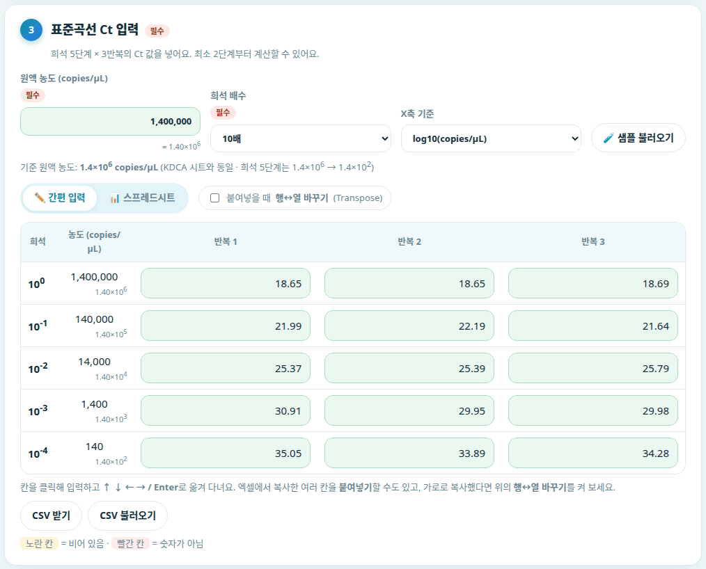
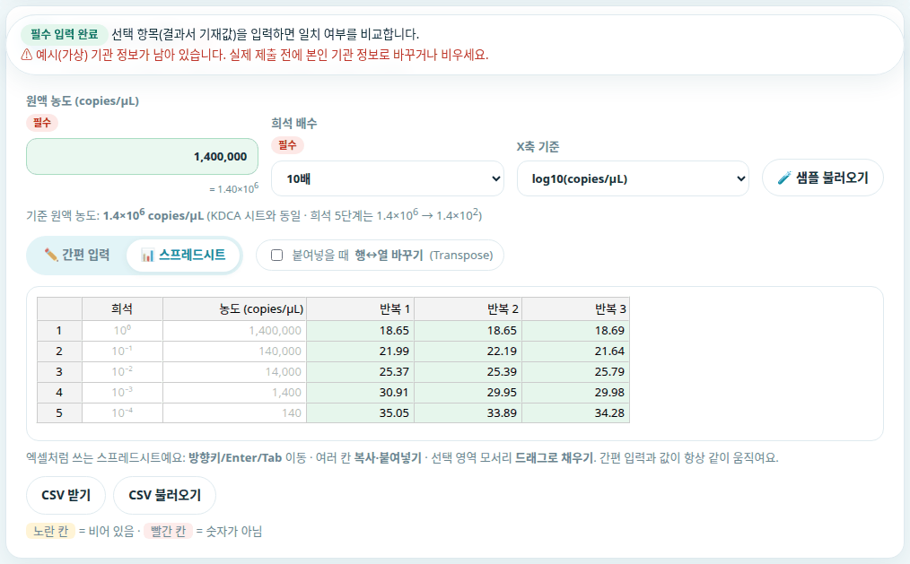
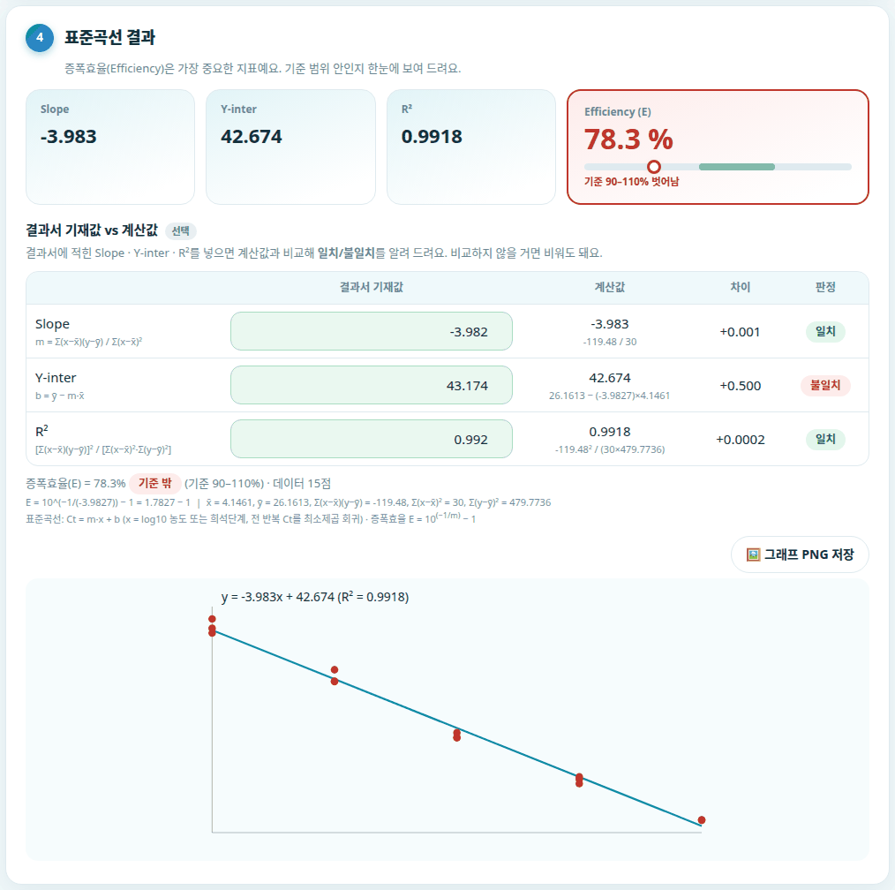
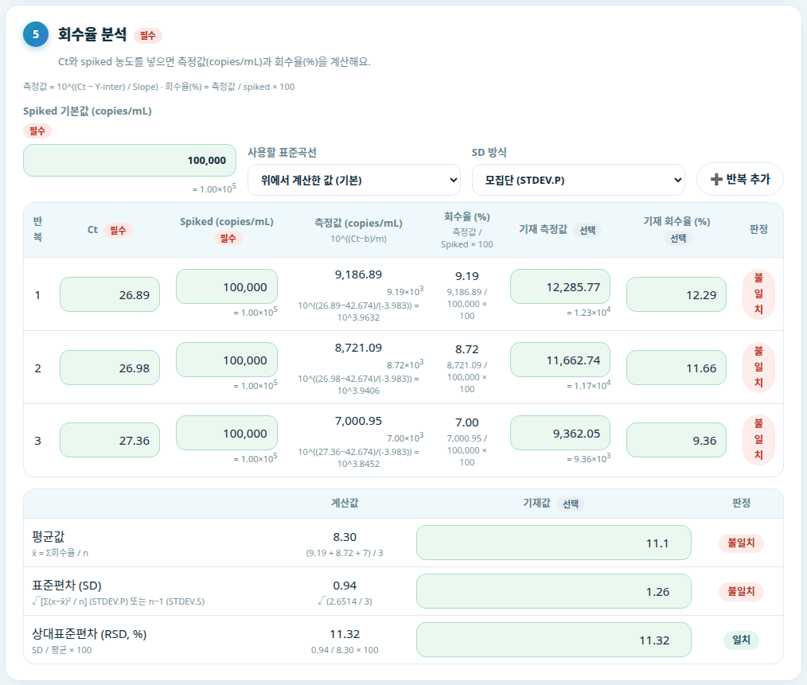
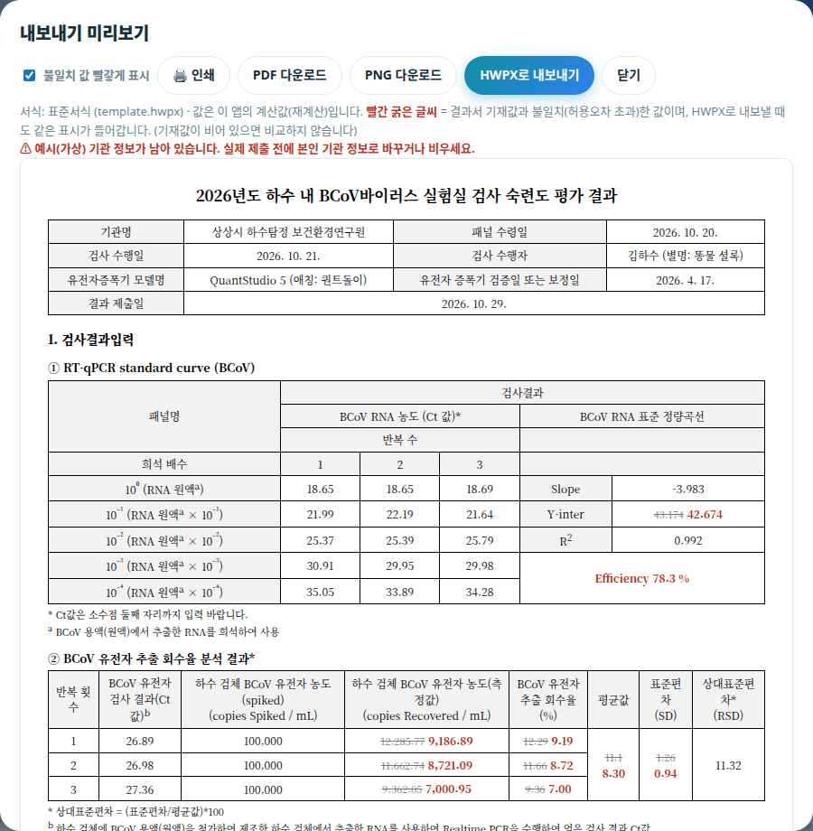
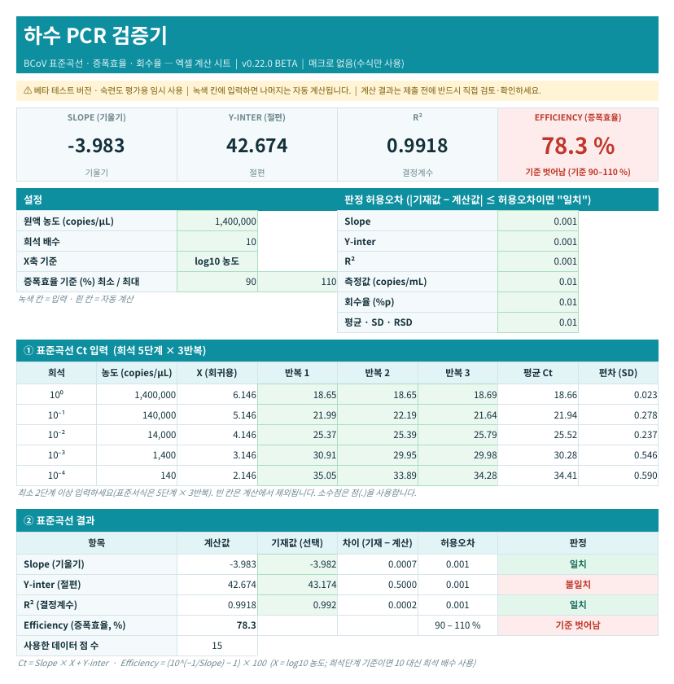
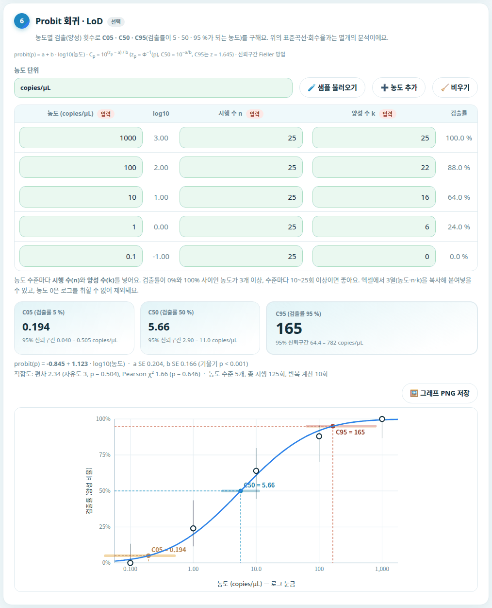

# HeavelyLab (LabPhobia)

*Formerly "WasteWater PCR Validator" (repository name unchanged).* This program is a small lab toolbox with three tabs: **Linearity Test** (standard curve, efficiency, recovery), **Probit analysis (LoD)** and **7500FAST** (open `.eds` run files).


[](https://github.com/CHOICHI-HWAN/WasteWaterPCRValidator/actions/workflows/ci.yml)


[](https://wwpcr.web.app)


[한국어](README.ko.md)

> **Notice: beta, for temporary use in the proficiency test.** This tool was made to help re-check the numbers of the *wastewater pathogen detection proficiency test* (BCoV RT-qPCR). It is **beta software, not a validated laboratory system.** Results, and the result forms it exports, must be **reviewed by a person before they are submitted**. No warranty is given.

**Try it: <https://wwpcr.web.app>** (demo with sample data: <https://wwpcr.web.app/?demo=1>) · [Windows app](#windows-app-exe) · [Excel workbook](#excel-workbook)

A browser tool that takes the Ct values of the BCoV standard curve and the extraction-recovery samples, **re-computes Slope, Y-intercept, R², amplification efficiency and recovery**, compares them with the values written on a result form (HWPX), and writes a corrected result form. Nothing is sent to a server. *(The interface is in Korean.)*


## Features

### Check the numbers

1. **Standard curve from the raw Ct values.** Least-squares regression over all points (5 dilutions x 3 replicates; blanks are skipped): Slope, Y-intercept, R². The reference stock concentration is **1.4 x 10^6 copies/uL** (the KDCA sheet's); other values are warned about.
2. **Efficiency, front and centre.** `E = 10^(-1/Slope) - 1` with a gauge against a configurable range (default 90-110 %), in the app, in the exported form and in the Excel workbook.
3. **Compare with the form.** Type (or upload) the values written on the form; each one is judged *match / mismatch* against a tolerance you can change (defaults: 0.001 for Slope, Y-inter and R^2; 0.01 for the rest).
4. **Recovery analysis.** Ct + spiked concentration -> measured concentration (copies/mL) and recovery (%), with mean, SD (population or sample) and RSD, using either the curve calculated above (default) or the one written on the form.
5. **Formulas shown with the numbers filled in** (`-119.48 / 30`, `26.1613 - (-3.9827) x 4.1461`), so every value can be checked by hand; the switch in the header hides them.

5b. **Probit regression / detection limit (LoD).** From the number of positives out of the replicates tested at each concentration, fits `probit(p) = a + b log10(conc)` by maximum likelihood and reports **C05, C50 and C95** (the concentrations with 5 %, 50 % and 95 % detection) with Fieller 95 % intervals, goodness of fit, a detection-rate curve and warnings (extrapolation, wide intervals, complete separation). Validated against an independent optimiser and a classic published data set. Shown in its own tab with a MedCalc-style dose-response plot (95 % band) and table.

5c. **7500FAST tab.** Try the built-in synthetic sample or drop an Applied Biosystems 7500 Fast `.eds` result file to see the run summary, the 96-well plate layout, amplification curves (ΔRn / Rn, log axis, thresholds, Ct marks), a sample x target mean-Ct table and the result table (CSV export). Thresholds can be set by hand (Ct is recalculated on screen) and the result can be saved as a preview / print / PDF / PNG report or an **HWPX** file. Read in your browser only.

### Result forms (HWPX)

6. **Read a filled-in form.** Upload a `.hwpx` result form; Ct values, reported Slope / Y-inter / R^2, recovery rows and institution info are read in your browser (not uploaded).
7. **Standard form and template.** The form is built in; a blank input template (inputs in green) can be downloaded, filled in Hangul and uploaded again.
8. **Export.** The corrected form (HWPX) keeps the original layout; values that **disagree with the reported ones are written in red bold**. A drawn *BCoV standard curve* figure and the Efficiency are added. A **preview** laid out like the real form, plus **print**, **PDF** and **PNG**, are provided.

### Entering data comfortably

9. **Two ways to type Ct values**: a simple grid or a real spreadsheet ([Jspreadsheet CE](https://github.com/jspreadsheet/ce)), sharing the same data. Arrow keys / Enter / Tab, copy-paste from Excel (with *transpose*, automatic for a 3 x 5 block), drag-fill, CSV in and out.
10. **Strict number parsing.** `18,65` (decimal comma) or `18.65abc` is *rejected with the reason* instead of being silently read as 1865 / 18.65. Thousands separators, `1.4e6`, `%` and full-width digits are accepted. Display rounding follows Excel/Hangul (`1.005 -> 1.01`).
11. **Required / optional marks, date pickers with validation, thousands separators and scientific notation** beside large numbers.

### Take it with you

12. **Excel workbook with live formulas** - the current inputs, `SLOPE/INTERCEPT/RSQ`, judgements, a chart with the trend line; no macros. Its formulas were re-calculated with LibreOffice and match the app.
13. **Windows app (2.8 MB)** - one file, no install, no internet; opens in your browser and closes itself when you close the tab.
14. **Private by design.** Inputs and uploaded files never leave your computer. (The web site records anonymous visit statistics; the Windows app makes no outside connections.)

## Screenshots

| | |
|---|---|
|  |  |
| Standard-curve input (simple grid) with the reference concentration | The same data in the spreadsheet tab |
|  |  |
| Slope, Y-inter, R^2 and Efficiency cards; match / mismatch against the form | Recovery with formulas filled in, mean / SD / RSD |
|  |  |
| Export preview (mismatches in red bold; print / PDF / PNG / HWPX) | Excel workbook (live formulas, no macros) |
|  | |
| Probit regression: C05 / C50 / C95 with 95 % intervals and the detection-rate curve (sample data) | |

## How to use

### Web app (recommended)

1. Open <https://wwpcr.web.app>.
2. **Load**: upload your result form (`.hwpx`) - or download the **input template**, fill the green cells and upload it - or type the Ct values directly (try **Load sample**).
3. **Check the red/yellow marks**: *required* inputs must be filled; the result cards, the match/mismatch column and the Efficiency gauge update as you type.
4. **Export**: *Preview* -> **HWPX**, **Print / PDF**, **PNG**, or the **Excel workbook**. The right-hand panel lists everything that can be downloaded.

### Windows app (exe)

Download the zip from the **Releases** panel of the web site (or [docs/RELEASING.md](docs/RELEASING.md) to build it), unzip, double-click `WasteWaterPCRValidator-win-x64.exe`. Windows 10/11 (64-bit). It opens the app in your default browser at `http://127.0.0.1:47321/`, works offline, and exits a few seconds after you close the tab. The file is **not code-signed**, so Windows SmartScreen may warn once: *More info -> Run anyway* (the zip contains the SHA-256 to check).

### Excel workbook

*Export -> Excel calculation sheet.* Green cells are inputs; everything else is a formula. It has a banner, result cards, the judgements and a chart, and prints on A4.

### Run it locally / develop

No build step; it is static files.

```bash
git clone https://github.com/CHOICHI-HWAN/WasteWaterPCRValidator.git
cd WasteWaterPCRValidator
python3 -m http.server 8000 --directory public    # then open http://localhost:8000
npm test                                           # unit tests (Node 18+)
```

| Command | What it does |
|---|---|
| `npm test` | Calculation, number parsing, rounding, probit and version-consistency tests |
| `npm run sync-docs` | Copy `LICENSE` / `CHANGELOG` / `THIRD_PARTY_NOTICES` into `public/` (shown in the app) |
| `npm run build:exe` | Build the Windows exe with Go (`--arm64`, `--linux` variants in `tools/build-exe.mjs`) |
| `npm run release` | Build the exe and the zip + `releases.json` for the site's Releases panel |
| `npm run deploy` | `release`, then deploy to Firebase Hosting |

## How the numbers are computed

| Quantity | Formula |
|---|---|
| X (regression) | `log10(concentration)` of each dilution (or the dilution step) |
| Slope `m`, Y-inter `b` | least squares of Ct on X over all non-blank points |
| R^2 | `[Sxy]^2 / (Sxx * Syy)` |
| Efficiency | `(10^(-1/m) - 1) x 100` (with the dilution factor instead of 10 for step-based X) |
| Measured (copies/mL) | `10^((Ct - b) / m)` |
| Recovery (%) | `measured / spiked x 100` |
| Mean / SD / RSD | over the recovery values; SD is population (`STDEV.P`, as on the form) or sample (`STDEV.S`) |

All arithmetic is IEEE-754 double (checked against exact rational arithmetic: error about 4e-16). A mismatch is `|reported - calculated| > tolerance`.

## Project layout

```
public/                  # the whole web app (static files, deployed as is)
  index.html  app.js     # UI and wiring
  calc.js num.js         # regression/recovery, strict number parsing, rounding
  probit.js              # probit regression, C05/C50/C95, Fieller intervals, special functions
  hwpx.js                # read and write HWPX (zip + XML)
  xlsx-export.js         # Excel workbook with live formulas
  chart.js releases.js   # standard-curve figure, Releases side panel
  template.hwpx          # the standard form (inputs blank, green)
  vendor/                # bundled libraries (no CDN): Jspreadsheet CE, JSZip, html2canvas, jsPDF
desktop/go/              # the Windows launcher (Go, about 2.8 MB with the app inside)
tools/                   # build-exe, release, sync-docs, make_template.py
test/                    # unit tests
docs/img/                # screenshots
```

## Limitations

- **The reference concentration matters.** The Y-intercept and the measured values depend on the concentration assigned to the first standard; slope, R^2 and efficiency do not. The KDCA sheet uses 1.4 x 10^6 copies/uL, the KAD sheet 4 x 10^6 (quantity x 40), which changes the intercept by 1.54 and every measured value by x2.857. Use the value your protocol defines.
- The form asks for Ct to two decimals; if the original calculation used more, a recalculation from the rounded numbers differs slightly (about 3e-4 in the slope).
- HWPX files are written to the same structure as the original form, but they have **not been opened in Hangul by the authors** while developing; please report any layout problem.
- The Windows exe is cross-compiled and unsigned; its server code was tested with the Linux build of the same source.
- The Excel workbook was verified by recalculating it in LibreOffice, not in Microsoft Excel.
- The sample data in the demo are numbers from an example result form, not a recommendation.

## Documentation

[CHANGELOG.md](CHANGELOG.md) · [THIRD_PARTY_NOTICES.md](THIRD_PARTY_NOTICES.md) · [docs/RELEASING.md](docs/RELEASING.md) · [LICENSE](LICENSE)

## Contributing and license

Bug reports and ideas: [Issues](https://github.com/CHOICHI-HWAN/WasteWaterPCRValidator/issues). Licensed under the GNU General Public License v3.0 ([LICENSE](LICENSE)), © 2026 치치박사 & 박박사. Third-party components and their licenses (Jspreadsheet CE, jsuites, JSZip, html2canvas, jsPDF - MIT; Firebase SDK - Apache-2.0; Go runtime - BSD-3-Clause) are listed in [THIRD_PARTY_NOTICES.md](THIRD_PARTY_NOTICES.md).
